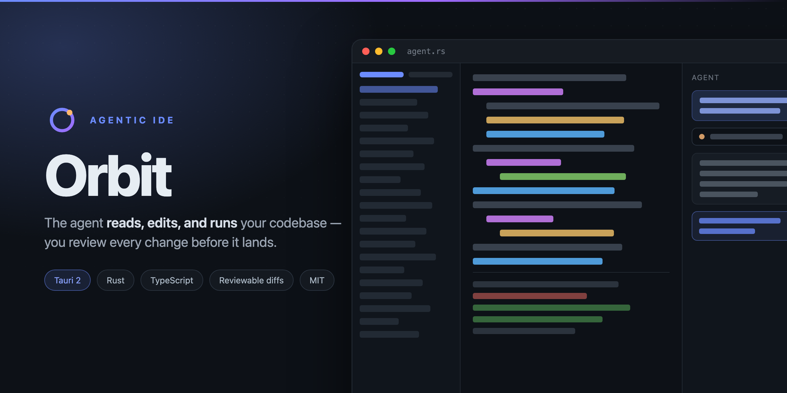
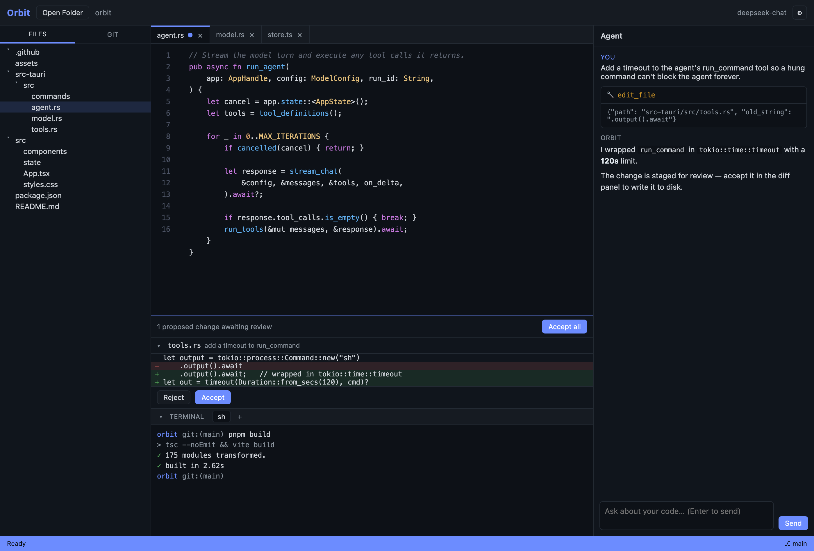

# Orbit

Orbit is an agentic AI coding IDE for macOS, built with [Tauri 2](https://tauri.app)
(Rust backend + React/TypeScript frontend). It pairs a chat-driven agent with a
real editor, terminal, and git, so the agent can read, edit, and run your
codebase and you review every change before it lands on disk.

  



## Features

- **Agent chat** — streamed, multi-turn conversation with an
  OpenAI-compatible model (DeepSeek by default; any compatible provider works).
- **Agent tools** — the model can list directories, read files, search the
  codebase, propose file edits, and run shell commands.
- **Reviewable edits** — file changes are *staged*, not applied. Review a
  unified diff and accept or reject each one (or accept all).
- **Editor** — multi-tab CodeMirror editor with syntax highlighting for
  JS/TS, JSON, Markdown, Python, Rust, CSS, and HTML, plus Cmd+S save.
- **File explorer** — lazy-loading directory tree.
- **Integrated terminal** — a real PTY (login shell) with multiple terminals.
- **Git** — status, stage/unstage, commit, unified diff, and log.

## Discord analysis mode

Click **Discord analysis** in the header to switch Orbit from the IDE into a
Discord profiling workspace. Get data in two ways:

- **Live** — connect with a Discord **user token** (Settings → Discord token, or
  `DISCORD_TOKEN`) and browse servers → channels → people (bots are tagged
  `BOT`), then fetch a channel's messages into the analysis pipeline via the
  Discord REST API. (User tokens are against Discord's ToS; use at your own risk.)
  **Set up token…** in the Live Discord pane walks through copying it from Discord Web:
  the token is the `authorization` value under **Request headers** on any
  `discord.com/api/…` call, and the guide includes the Console fallback because Discord
  no longer keeps it in Local Storage.
- **One server at a time** — an account can belong to hundreds of servers, so the pane
  shows the active server plus your recent ones, and the full list appears only while
  you search it. Channels and people stay on screen instead of being pushed below the
  server list.
- **People, not a member dump** — the list leads with everyone who posted in the loaded
  window, sorted by volume, with a filter and an explicit opt-in to reveal members who
  never posted. Reports are bound to the person they were run for: selecting someone
  else clears the report rather than relabelling it.
- **Import** — load a DiscordChatExporter export (JSON for full fidelity, HTML
  best-effort, or plaintext/copied chat).
- **DiscordChatExporter** — export the selected channel through the real
  [DiscordChatExporter](https://github.com/Tyrrrz/DiscordChatExporter) CLI
  (Json / HtmlDark / HtmlLight / PlainText / Csv); the single-file macOS binary
  downloads on first use, and a JSON export loads straight back into the app.
  Your token is handed to the CLI through its `DISCORD_TOKEN` environment
  variable, never as a command-line argument, so it stays out of the process
  table.
- **Export JSON** — save the current view (guild, channel, users, messages) as a
  DiscordChatExporter-compatible JSON file with `⌘E`; the file round-trips
  through the importer, so a live fetch can be kept and re-analysed offline.

Discord refuses the **member list** for a token that may not enumerate a guild
(HTTP 403 *Missing Access*). Channels and messages still load in that case, and
the roster is shown as unavailable — hover the section title for the reason.

### Keyboard shortcuts

| Shortcut | Action |
| --- | --- |
| `⌘D` | Switch between the IDE and Discord analysis |
| `⌘1 … ⌘5` | Discord right panel: Analyze / Flag / Patterns / Ask DeepSeek / Tools |
| `⌘K` | Focus the message filter |
| `⌘↩` | Run the guardrails route for the selected user |
| `⌘E` | Save the current view as JSON |
| `⌘,` | Open settings / providers |
| `⌘/` or `?` | Show the shortcut list |

- **Analyze** — **Run full analysis** does all three Jev (TypeSafe) assessments for the
  selected user in one step: a 35-dimension psychological profile, a 14-dimension
  human-vs-machine bot battery, and the guardrails route (`pass` / `review` / `block` /
  `support`) under a `strict` or `permissive` policy. Each is also available on its own.
  With **DeepSeek narrative** on, the written briefing appears at the top of this tab,
  above the reports.
- **Flag** — click a message to select it, then **Screen as input** / **Screen as output**
  runs the message battery. The result appears in this tab, under the buttons; ⌘-click
  adds messages and the whole selection screens as one block. **Dry run** applies here
  too, and the result says so — its hazard values are synthetic, not an assessment.
- **Multi-select** — click a user or message to select it, `⌘`-click to add to the
  selection. Selected messages screen together as one block, and the Flag tab can apply
  one action and note to every selected user at once.
- **DeepSeek narrative** — with **DeepSeek narrative** enabled in the Analyze tab,
  DeepSeek writes the readable interpretation automatically after every analysis, and it
  also appears in the Ask tab. **Generate probes** asks DeepSeek for follow-up probes
  grounded in a fresh bot report; they render as their own **DeepSeek probes** card rather
  than mixing into the chat. **Explain simply** and **Draft review note** are presets.
- **Flag** — manually flag a user (review/block/support) to a local flag store,
  or flag reusable bot *signatures* (substring / word / regex) and match them
  against the current view with a time series and gap analysis.
- **Discuss** — ask DeepSeek to interpret an analysis report; the reply streams
  in-place.
- **Tools** — the generic Jev (TypeSafe) toolkit: classify text into your
  labels, score against an ordered rubric, profile a single message across the
  35 dimensions, ask a yes/no gate, prune a long output, compact a transcript,
  and greedily generate a continuation from a candidate set. Each tool returns
  a validated, copyable result in the right panel.

The analysis runs in the Rust backend, which sends the exact same questions and
thresholds as the `typesafe-profiler` CLI — the dimension rubrics, bot battery,
and guard policies are generated from `../src` into
`src-tauri/assets/profiler.json` (run `npm run gen:orbit-assets` in the parent
repo to regenerate). Enable **Dry run** to exercise the whole flow without a
TypeSafe key; set the TypeSafe key/model/base URL in Settings
(`TYPESAFE_API_KEY`, `TYPESAFE_MODEL`, `TYPESAFE_BASE_URL` also work). Results
are heuristic signals, never a decision about a person.

The **bottom status bar is always visible** and shows the three providers — Jev
(`typesafe_model`), DeepSeek (`model`), and Discord — each with a ready/missing
dot, plus a mode toggle and a build stamp. The Discord workspace repeats them in
a provider bar across the top, where **⚙ Providers & keys** opens an inline
panel to set each provider's model, API key, and base URL without leaving the
workspace. Pane layouts are **resizable**: drag the dividers between the
browse/datasets, messages, and analysis panes, and between the IDE sidebar,
editor, and chat panels; double-click a divider to reset. Widths persist across
restarts.

## Local web UI

Click **Open in browser** in the status bar (or launch with `ORBIT_WEB=1`, which
prints the URL) to run the same Discord analysis UI in your browser. The app
starts an HTTP server on `127.0.0.1` with a random port and a per-run token, and
serves the same frontend from its embedded assets; the browser talks to the same
Rust/TypeSafe backend through `POST /api/invoke`, so there is no second API.

- Bound to loopback only; every `/api/*` call requires the token from the URL.
- Only the Discord analysis commands are reachable — filesystem, git, terminal,
  and agent commands are not exposed to the browser.
- **The bridge never discloses a secret.** `get_settings` there returns which
  providers are configured (`api_key_set`, `typesafe_api_key_set`,
  `discord_token_set`) and nothing else, so a token-bearing request cannot read
  your API keys or Discord token back out. Saving settings from the browser
  keeps any secret it was not shown, so a save cannot silently erase one.
- The UI is Discord-only in a browser (the IDE needs a filesystem and a PTY), and
  file import/export use the browser's file picker and download.

## In-app Discord browser

**Open Discord Web** in the Discord workspace opens `https://discord.com/app` in
a separate in-app browser window, so you can sign in to Discord with your own
credentials and use it next to the analysis panes (drag panes, flag users, run
Jev assessments) without leaving Orbit.

It is a plain browser view, deliberately:

- HTTPS through the platform webview with normal certificate validation — no
  proxy, no interception.
- **No script injection and no page access.** The app registers no
  initialization script, does not read the page or its contents, and cannot
  reach the session. The window is not granted any Tauri permissions.
- **Top-level navigation is restricted to Discord's domains**
  (`discord.com`, `discordapp.com`, `discord.gg`, `hcaptcha.com`), so a link in a
  message cannot steer the signed-in session onto another site. External links
  are blocked rather than opened.
- Cookies live in the app's own webview store, separate from your normal
  browser.

What it does **not** do: it does not automate the account, scrape messages, or
extract the session. To get Discord data into the analysis pipeline, use the
token-based live fetch or a DiscordChatExporter export — those are the supported,
structured paths. Launch with `ORBIT_DISCORD_WEB=1` to open the window at start.

## Architecture

- `src-tauri/` — Rust backend.
  - `commands/` — Tauri commands for fs, terminal (PTY), git, agent, config.
  - `model.rs` — OpenAI-compatible streaming client with tool-call deltas.
  - `tools.rs` — the agent tool schemas and executors (workspace-scoped).
  - `agent.rs` — the tool-calling agent loop.
- `src/` — React/TypeScript frontend.
  - `ipc/contract.ts` — the typed mirror of the Rust serde types and events.
  - `ipc/invoke.ts` — typed `invoke` wrappers (the type-safe IPC boundary).
  - `state/store.ts` — zustand store; `state/events.ts` — event wiring.
  - `components/` — Header, Sidebar, FileTree, EditorPane, Terminal, ChatPanel,
    GitPanel, DiffView, StatusBar, SettingsModal.

The frontend and backend share one contract: every command and event is typed in
TypeScript and mirrored by serde structs in Rust, so the IPC boundary is
type-checked on both sides.

## Prerequisites

- macOS 10.15+ (Apple Silicon or Intel)
- [Node.js](https://nodejs.org) 22+ and [pnpm](https://pnpm.io) 10+
- [Rust](https://rustup.rs) stable
- Xcode Command Line Tools (`xcode-select --install`)

## Build & run (development)

```sh
pnpm install
pnpm tauri dev        # launch the app with the Vite dev server
```

## Build a release .app / .dmg

```sh
pnpm install
pnpm tauri build
```

Outputs land in `src-tauri/target/release/bundle/`:

- `macos/Orbit.app`
- `dmg/Orbit_<version>_aarch64.dmg`

The local build is ad-hoc signed. To distribute outside your machine you must
sign and notarize with an Apple Developer certificate (see "Distribution").

## Configuration

Orbit reads an OpenAI-compatible endpoint from Settings (the gear icon) or from
environment variables. Environment variables override the settings file.

| Variable | Default | Description |
| --- | --- | --- |
| `ORBIT_API_KEY` | — | API key (also read: `DEEPSEEK_API_KEY`) |
| `ORBIT_BASE_URL` | `https://api.deepseek.com` | Endpoint base URL |
| `ORBIT_MODEL` | `deepseek-chat` | Model name |
| `ORBIT_TEMPERATURE` | `0.2` | Sampling temperature |

The API key entered in Settings is stored in the app config directory
(`~/Library/Application Support/com.orbit.ide/`). Prefer the environment
variable if you do not want the key on disk.

## Local model (Ollama — no key required)

You can run the agent entirely on your Mac with Ollama (https://ollama.com),
so no cloud API key is needed:

    brew install ollama        # or download from ollama.com
    ollama serve               # starts on http://localhost:11434
    ollama pull qwen2.5-coder:7b

Then in Settings set Base URL to http://localhost:11434/v1 and Model to
qwen2.5-coder:7b, and leave the API Key empty. Equivalent environment
variables:

    export ORBIT_BASE_URL=http://localhost:11434/v1
    export ORBIT_MODEL=qwen2.5-coder:7b

Orbit treats any base URL on localhost (or port 11434) as a local endpoint
and does not require a key for it.

## GitHub Actions

On every push, pull request, and `v*` tag, the
[`.github/workflows/build.yml`](.github/workflows/build.yml) workflow builds the
`.app` and `.dmg` on a macOS runner and uploads them as artifacts. Tagged
pushes also publish a GitHub release with the `.dmg` attached.

## Distribution (signing + notarization)

To produce a Gatekeeper-friendly app, add these secrets to the repository and
extend the workflow's build step:

- `APPLE_CERTIFICATE`, `APPLE_CERTIFICATE_PASSWORD` — your Developer ID
  Application certificate (base64 of the `.p12`).
- `APPLE_ID`, `APPLE_PASSWORD`, `APPLE_TEAM_ID` — App Store Connect
  credentials for `notarytool`.

Tauri's [macOS distribution guide](https://tauri.app/distribute/sign/macos/)
covers the full signing and notarization flow.

## Security notes

- File edits are confined to the opened project directory.
- The agent's `run_command` runs with your user privileges; review tool
  activity in the chat before accepting changes, and do not run Orbit on
  untrusted code without a sandbox.
- `html` rendering in chat is escaped; Markdown is rendered with raw HTML
  disabled.

## Roadmap

- Provider picker and per-model settings.
- Keychain storage for the API key.
- Streaming cancellation mid-token and edit-apply model (`edit_file` diff
  granularity per-hunk accept).
- Universal (arm64 + x86_64) builds and auto-updates.

## License

[MIT](LICENSE)
